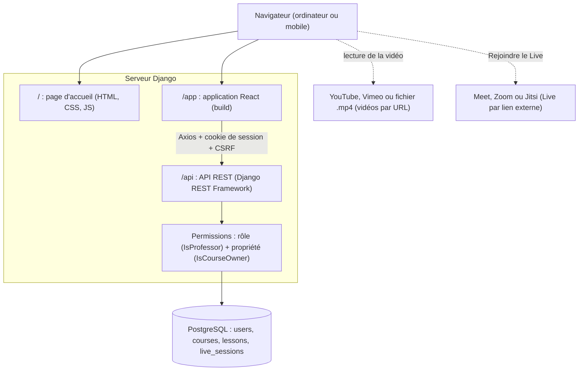
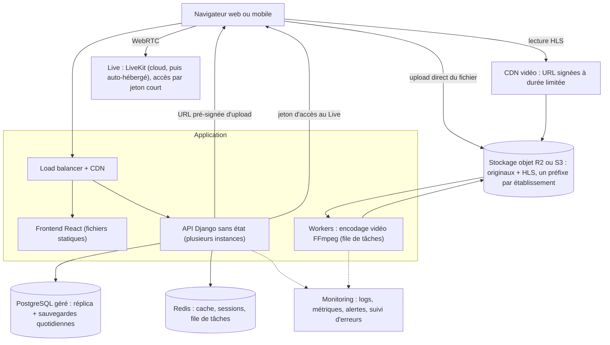

# Architecture – CoursLive

Les schémas sont écrits en Mermaid : GitHub les affiche directement dans ce fichier.

## 1. Architecture actuelle (prototype)

**Points clés**
- Une seule application Django sert la page d'accueil, le build React (`/app`) et l'API (`/api`) : une seule URL, pas de CORS.
- L'authentification repose sur une session (cookie HttpOnly) et un jeton CSRF.
- Chaque requête d'écriture passe par les permissions : le rôle puis la propriété du cours.
- Les vidéos et les Lives sont des liens externes : le serveur ne stocke et ne diffuse aucune vidéo.

## 2. Évolution envisagée (plusieurs établissements, plusieurs milliers d'utilisateurs)

**Ce qui change par rapport au prototype**

| Sujet | Prototype | Évolution |
|---|---|---|
| Vidéos | URL externes | Upload direct vers un stockage objet (le serveur principal ne voit pas les gros fichiers), encodage HLS par des workers, lecture via CDN et URL signées |
| Live | Lien externe | Salle intégrée (LiveKit) ; Django vérifie le droit d'accès puis délivre un jeton court |
| Établissements | Un seul espace | Colonne d'établissement sur chaque table, filtrage systématique dans l'API, préfixe de stockage par établissement |
| Montée en charge | Un serveur | API sans état derrière un load balancer, PostgreSQL géré avec réplica, Redis pour le cache et les tâches |
| Fiabilité | Aucune sauvegarde | Sauvegardes quotidiennes de la base, second exemplaire des originaux vidéo, reprise des tâches d'encodage en cas d'échec |
| Exploitation | Aucun suivi | Logs centralisés, métriques, alertes de coût et d'erreurs, déploiement avec retour rapide à la version précédente |
